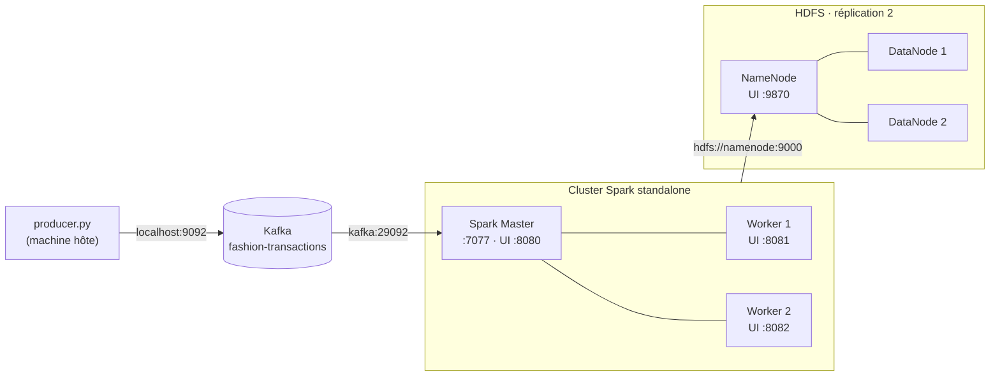
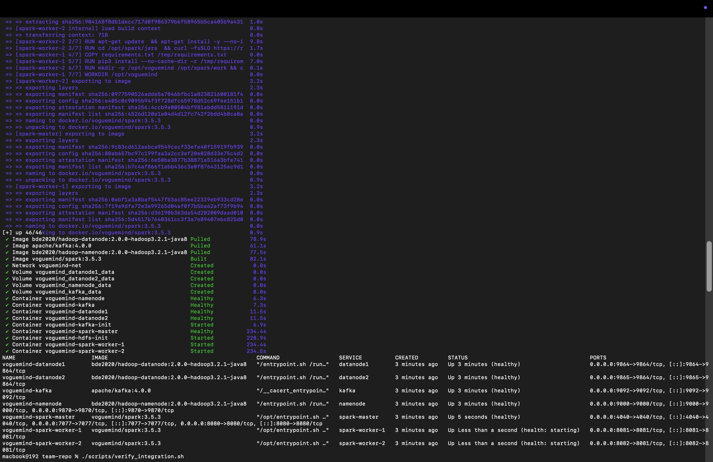
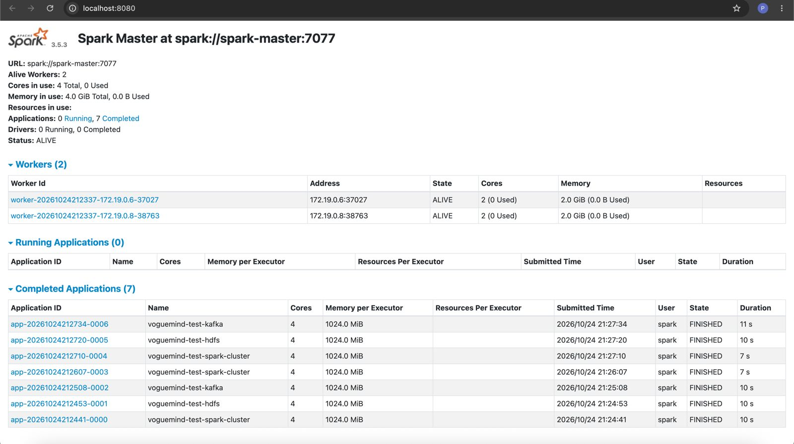
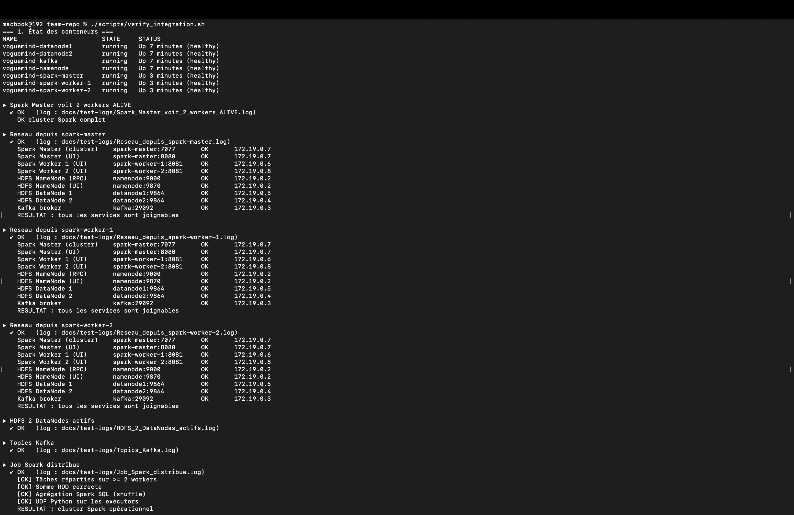
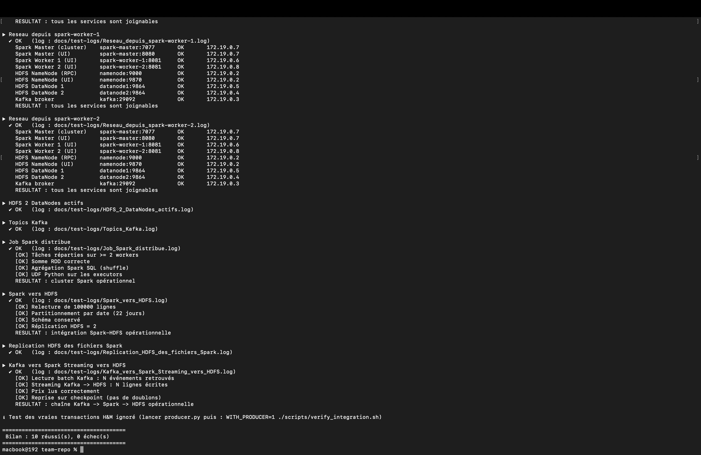
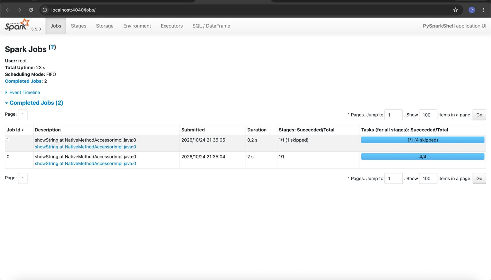
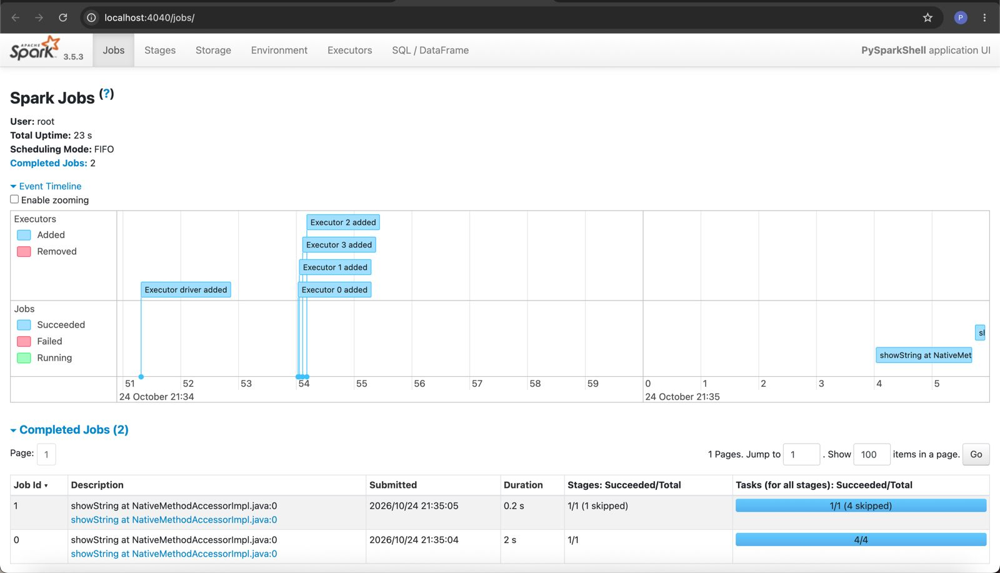
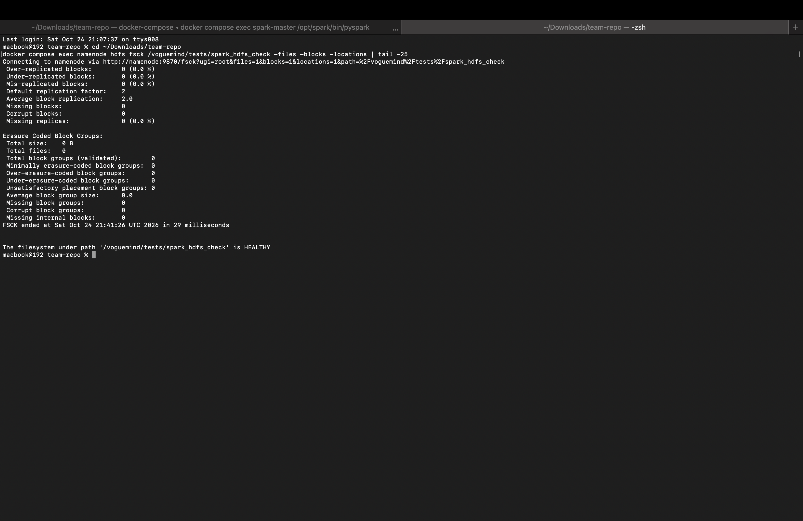

# Apache Spark + Intégration — VogueMind

Réalisée par : Nada Rian

Responsabilité : Cluster Apache Spark (1 Master + 2 Workers) et intégration des services Spark, HDFS et Kafka dans le Docker Compose commun.

## 1. Présentation

Cette partie fournit la **couche de traitement** du pipeline VogueMind et assemble les trois briques de l'infrastructure (Kafka, HDFS, Spark) dans un **seul `docker-compose.yml`**, à la racine du dépôt. Tous les conteneurs partagent le réseau Docker `voguemind-net` et se joignent par leur nom d'hôte.

Objectifs de la semaine 1 :

- déployer un cluster Spark standalone : 1 Master et 2 Workers distincts ;
- intégrer HDFS (configuration de Salma Hilali) et Kafka (configuration de Safae Benhaddou) dans le compose commun ;
- vérifier la communication entre tous les conteneurs ;
- tester le cluster Spark, puis les chaînes Spark → HDFS et Kafka → Spark → HDFS.

## 2. Architecture du cluster



| Service | Conteneur | Image | Ports hôte | Rôle |
|---|---|---|---|---|
| `spark-master` | `voguemind-spark-master` | `voguemind/spark:3.5.3` | 8080, 7077, 4040 | Ordonnancement, driver des jobs |
| `spark-worker-1` | `voguemind-spark-worker-1` | `voguemind/spark:3.5.3` | 8081 | Exécution des tâches |
| `spark-worker-2` | `voguemind-spark-worker-2` | `voguemind/spark:3.5.3` | 8082 | Exécution des tâches |
| `namenode` | `voguemind-namenode` | `bde2020/hadoop-namenode:2.0.0-hadoop3.2.1-java8` | 9870, 9000 | Métadonnées HDFS |
| `datanode1/2` | `voguemind-datanode1/2` | `bde2020/hadoop-datanode:2.0.0-hadoop3.2.1-java8` | 9864, 9865 | Blocs HDFS |
| `kafka` | `voguemind-kafka` | `apache/kafka:4.0.0` | 9092 | Broker KRaft |
| `hdfs-init`, `kafka-init` | — | — | — | Initialisation unique (dossiers, topics) |

## 3. Choix techniques

| Choix | Justification |
|---|---|
| Image officielle `spark:3.5.3-scala2.12-java17-python3-ubuntu` | Image maintenue par Apache, version figée, Python 3 inclus pour PySpark |
| Image Spark personnalisée (`infra/spark/Dockerfile`) | Le connecteur Kafka (`spark-sql-kafka-0-10` 3.5.3, `kafka-clients` 3.4.1, `commons-pool2` 2.11.1) est intégré à la construction : aucun `--packages` ni téléchargement au lancement, ce qui rend le dépôt reproductible. `numpy` est installé pour Spark ML. |
| **Même image** pour le master et les workers | Même version de Spark et de Python sur le driver et les executors (sinon les UDF Python échouent) |
| `spark.hadoop.dfs.replication 2` | Sous HDFS, la réplication est choisie **par le client qui écrit**. Sans ce paramètre, Spark écrit avec la valeur Hadoop par défaut (3) et les blocs restent « under-replicated » avec seulement 2 DataNodes. |
| `HADOOP_USER_NAME=root` | Les jobs Spark écrivent dans HDFS avec le même utilisateur que celui qui a créé `/voguemind`, sans conflit de droits |
| **Deux listeners Kafka** | La configuration initiale annonçait seulement `localhost:9092` : un conteneur Spark qui se connecte reçoit cette adresse et tente de joindre… lui-même. On garde `localhost:9092` pour `producer.py`/`consumer.py` (aucune modification) et on ajoute `kafka:29092` pour les conteneurs. |
| `depends_on` + `healthcheck` | Ordre de démarrage garanti : HDFS et Kafka sains → Spark Master sain → Workers |
| Ressources : 2 cores / 2 Go par worker, executors 1 core / 1 Go | Tient sur un poste avec 8 Go alloués à Docker ; modifiable dans `.env` |

Fichiers de configuration :

```text
docker-compose.yml                  # compose commun
.env.example                        # ressources des workers, image Spark
infra/spark/Dockerfile              # image Spark + connecteur Kafka
infra/spark/requirements.txt        # dépendances Python figées
infra/spark/conf/spark-defaults.conf
infra/spark/conf/log4j2.properties  # logs réduits (WARN)
infra/hadoop/hadoop.env             # configuration HDFS partagée (réplication 2)
tests/integration/                  # tests de communication et d'intégration
scripts/verify_integration.sh       # lance tous les tests
```

## 4. Démarrage

```bash
cp .env.example .env                 # optionnel
docker compose up -d --build         # 1er lancement : 5 à 10 min
docker compose ps                    # tous les services "healthy", les init "exited (0)"
```

Si les conteneurs des compose individuels (`infra/docker-compose.hdfs.yml`, `infra/kafka-compose.yml`) tournent encore, les arrêter d'abord avec `docker compose -f <fichier> down` (mêmes noms de conteneurs). Les données HDFS déjà présentes ne sont pas reprises : le compose commun utilise ses propres volumes.

Interfaces web :

- Spark Master : http://localhost:8080 (doit afficher **Alive Workers: 2**)
- Workers : http://localhost:8081 et http://localhost:8082
- Application Spark en cours : http://localhost:4040
- HDFS : http://localhost:9870

## 5. Tests et vérifications

Tous les tests se lancent d'un coup (Mac/Linux, ou Git Bash/WSL sous Windows) :

```bash
./scripts/verify_integration.sh
```

Les sorties détaillées sont enregistrées dans `docs/test-logs/` (utiles pour les captures du rapport).

| # | Test | Commande | Résultat attendu |
|---|---|---|---|
| 1 | Workers enregistrés | `docker compose exec spark-master python3 /opt/voguemind/tests/integration/check_spark_workers.py` | `Workers ALIVE : 2` |
| 2 | Réseau entre conteneurs (depuis master, worker 1 et worker 2) | `docker compose exec spark-worker-1 python3 /opt/voguemind/tests/integration/check_network.py` | 9 services `OK` |
| 3 | HDFS vu par le cluster | `docker compose exec namenode hdfs dfsadmin -report` | `Live datanodes (2)` |
| 4 | Topics Kafka | `docker compose exec kafka /opt/kafka/bin/kafka-topics.sh --bootstrap-server kafka:29092 --list` | `fashion-transactions`, `integration-tests` |
| 5 | Job distribué sur le cluster | `docker compose exec spark-master /opt/spark/bin/spark-submit /opt/voguemind/tests/integration/test_spark_cluster.py` | Tâches exécutées sur `spark-worker-1` **et** `spark-worker-2`, calculs corrects |
| 6 | Spark → HDFS | `... spark-submit /opt/voguemind/tests/integration/test_hdfs_integration.py` | 100 000 lignes Parquet relues, réplication = 2 |
| 7 | Réplication des fichiers Spark | `docker compose exec namenode hdfs fsck /voguemind/tests/spark_hdfs_check -files -blocks -locations` | `Average block replication: 2.0`, `HEALTHY` |
| 8 | Kafka → Spark Streaming → HDFS | `... spark-submit /opt/voguemind/tests/integration/test_kafka_integration.py` | 500 événements publiés, relus, écrits dans HDFS ; aucune duplication à la reprise sur checkpoint |
| 9 | Vraies transactions H&M (optionnel) | `python ingestion/producer.py` puis `WITH_PRODUCER=1 ./scripts/verify_integration.sh` | Spark lit les 1 000 transactions envoyées par `producer.py` |

Le test 8 reproduit en petit la future voie chaude : lecture du topic en Structured Streaming, écriture Parquet dans HDFS avec checkpoint, puis relance du même job pour vérifier la **reprise** (exigence « vérification d'une reprise » du rapport).

## 6. Lancer un job Spark

Tous les traitements passent par le cluster :

```bash
docker compose exec spark-master /opt/spark/bin/spark-submit /opt/voguemind/batch/<job>.py
```

Les dossiers `ingestion/`, `batch/`, `streaming/`, `tests/` et `data/` du dépôt sont montés dans les conteneurs Spark sous `/opt/voguemind/`. Adresses à utiliser dans le code Spark :

- Kafka : `kafka:29092`
- HDFS : `hdfs://namenode:9000/voguemind/...` (`raw`, `processed`, `checkpoints`, `models`, `tests`)

## 7. Dépannage

| Symptôme | Cause probable | Solution |
|---|---|---|
| `Alive Workers: 0` ou 1 | Mémoire Docker insuffisante | Docker Desktop → Resources → 8 Go ; ou `SPARK_WORKER_MEMORY=1g` dans `.env` |
| `Conflict. The container name "/voguemind-namenode" is already in use` | Ancien compose individuel encore lancé | `docker compose -f infra/docker-compose.hdfs.yml down` |
| Port 8080 ou 9092 déjà utilisé | Autre application locale | Arrêter l'application ou changer le port hôte dans le compose |
| Job bloqué sur « Initial job has not accepted any resources » | Workers occupés par un autre job | Attendre la fin du job ou arrêter l'application dans l'UI 8080 |
| Lenteur des conteneurs Hadoop sur Mac M1/M2/M3 | Images `amd64` émulées | Normal ; activer « Use Rosetta » dans Docker Desktop |

## 8. Contribution (tableau du rapport)

| Étudiant | Tâches effectivement réalisées |
|---|---|
| Nada Rian | Conception de l'image Spark (Dockerfile, connecteur Kafka intégré, dépendances figées) ; configuration du Spark Master et des 2 Workers (ressources, `spark-defaults.conf`) ; création du `docker-compose.yml` commun intégrant HDFS, Kafka et Spark (réseau, healthchecks, ordre de démarrage, volumes, initialisation des dossiers HDFS et des topics) ; correction des listeners Kafka pour l'accès depuis les conteneurs ; scripts de vérification réseau et tests d'intégration (cluster Spark, Spark → HDFS avec réplication 2, Kafka → Spark Streaming → HDFS avec reprise sur checkpoint) ; documentation `infra/README-SPARK.md`. |

## 9. Captures d'écran

Les captures suivantes présentent le déploiement du cluster commun et la validation de l'intégration.

### 9.1. Déploiement du compose commun

Construction de l'image Spark, téléchargement des images Hadoop et Kafka, création du réseau `voguemind-net` et des 4 volumes persistants. Tous les services démarrent et deviennent `healthy` dans l'ordre défini par les `depends_on`.



### 9.2. Cluster Spark : Master et 2 Workers

L'interface du Spark Master (http://localhost:8080) affiche **2 workers `ALIVE`** (2 cœurs et 2 Go chacun, soit 4 cœurs et 4 Go au total). Les 7 applications terminées sont les tests d'intégration exécutés sur le cluster (`voguemind-test-spark-cluster`, `voguemind-test-hdfs`, `voguemind-test-kafka`).



### 9.3. Communication entre les conteneurs

Depuis le Master et depuis chacun des deux Workers, les 9 services du cluster sont résolus par leur nom (DNS Docker) et joignables sur leurs ports : Spark, NameNode, DataNodes et Kafka (`kafka:29092`). Le job de test s'exécute sur `spark-worker-1` et `spark-worker-2`.



### 9.4. Bilan des tests d'intégration

Le script `./scripts/verify_integration.sh` valide les 10 vérifications : écriture Spark → HDFS avec **réplication 2**, et chaîne **Kafka → Spark Structured Streaming → HDFS** avec reprise sur checkpoint sans doublons.



### 9.5. Interface de l'application Spark

Pendant une session PySpark soumise au cluster (http://localhost:4040), les jobs s'exécutent en tâches parallèles (4/4 tâches) et la frise montre l'ajout du driver puis de **4 executors** (Executors 0 à 3) répartis sur les deux Workers.





### 9.6. Réplication des données écrites par Spark

Le contrôle `hdfs fsck` sur `/voguemind/tests/spark_hdfs_check` (fichiers Parquet écrits par le job Spark) indique une **réplication moyenne de 2.0**, aucun bloc sous-répliqué, manquant ou corrompu, et un système **HEALTHY** : la réplication à 2 est bien appliquée aux écritures de Spark grâce au paramètre `spark.hadoop.dfs.replication 2`.



---

**Projet :** VogueMind
**Composant :** Apache Spark + Intégration
**Statut :** cluster déployé et validé localement — 10 tests d'intégration réussis sur 10.
